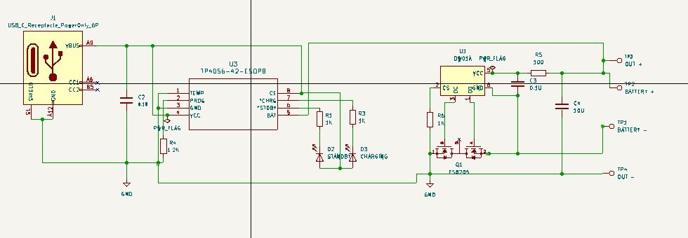

# Propuesta de trabajo práctico, Cargador Li-ion TP4056 (réplica)

Documentación de la propuesta acordada para el TP integrador de **DCI (CESE, FIUBA)**, cursada OCT–NOV–DIC 2026.

## Modalidad y referencia principal

| Campo                         | Valor                                                                                                                                                                 |
|-------------------------------|-----------------------------------------------------------------------------------------------------------------------------------------------------------------------|
| **Modalidad**                 | **Réplica** (rediseño en KiCad 10 de un cargador monocelda conocido)                                                                                                  |
| **Repositorio de referencia** | [Cyclone-92/TP4056-LiPo-charger-with-DW01A-and-FS8205A-MOSFET-protection](https://github.com/Cyclone-92/TP4056-LiPo-charger-with-DW01A-and-FS8205A-MOSFET-protection) |
| **Proyecto propio (KiCad)**   | `pcb/battery-charger/` en este repositorio                                                                                                                            |

El diseño original de Cyclone-92 combina:

- **TP4056**: carga lineal CC/CV hasta ~1 A para una celda Li-ion/LiPo (4,2 V).
- **DW01A**: IC de protección (sobrecarga, sobredescarga, sobrecorriente).
- **FS8205A**: par de MOSFET N de canal doble en el camino de batería, gobernados por el DW01A.

Referencias complementarias (misma topología, explicación didáctica):

- [Mischianti - Li-po battery charger with TP4056](https://mischianti.org/category/elettronica/elettronica-integrata/integrated/battery-charger/tp4056/)
  (artículos y esquemas de apoyo).

## Objetivo del circuito

Construir una **placa de carga y protección para una celda 18650** (3,7 V nominal), alimentada desde **USB 5 V**, con:

- Indicación de estado de carga (LEDs en `CHRG` / `STDBY` del TP4056).
- Protección de pack en el terminal negativo (`BAT−`) mediante DW01A + FS8205A.
- Salida de celda accesible en redes globales `BAT+` y `BAT−` (holder 18650 en el diseño propio).

## Adaptaciones respecto al original (Cyclone-92 )

| Aspecto             | Referencia Cyclone-92            | Este TP                                                       |
|---------------------|----------------------------------|---------------------------------------------------------------|
| Conector de entrada | Micro-USB / pads según su módulo | **USB-C receptáculo**, solo **VBUS + GND** (CC sin uso, `NC`) |
| Pasivos             | Según su BOM                     | **0805**, homogeneizados                                      |
| Software            | KiCad (versión del autor)        | **KiCad 10**, esquemático por bloques funcionales             |
| Huellas / 3D        | Según su repo                    | A completar en fases posteriores del TP                       |

El esquemático KiCad de referencia se guardó en este directorio como `referencia-cyclone92.kicad_sch` (copia tomada del
repositorio citado en la fecha de armado de esta carpeta).

## Imágenes del circuito / módulo de referencia

Vistas tomadas del repositorio Cyclone-92 (atribución al autor original; uso académico como documentación de réplica):

| Vista                     | Archivo local                                                                  |
|---------------------------|--------------------------------------------------------------------------------|
| Placa, frente (render 3D) | [imagenes-referencia/Front_3D_View.jpg](imagenes-referencia/Front_3D_View.jpg) |
| Placa, dorso (render 3D)  | [imagenes-referencia/Back_3D_View.jpg](imagenes-referencia/Back_3D_View.jpg)   |
| Esquemático (captura)     | [imagenes-referencia/Schematic.jpg](imagenes-referencia/Schematic.jpg)         |

### Vista rápida

## Esquemático de referencia (archivo)

- [TP4056-battery-charger-module-schema.pdf](TP4056-battery-charger-module-schema.pdf), esquemático declarado en el
  formulario (Mischianti).
- [referencia-cyclone92.kicad_sch](referencia-cyclone92.kicad_sch), esquemático KiCad del proyecto Cyclone-92 (solo
  consulta; el diseño entregable es `pcb/battery-charger/`).

## Corriente de carga programada

En el diseño propio, **R3 = 1,2 kΩ** en `PROG` del TP4056 (orden de magnitud ~1 A según hoja de datos; verificar cálculo
en notas propias si el docente lo exige).

## Notas para el formulario / checklist docente

- **Título del diseño (KiCad):** `Cargador Li-ion TP4056` (incluir la palabra *réplica* en el rótulo del esquemático al
  cerrar documentación, si la consigna lo pide).
- **Datasheets de ICs relevantes:** copias en `info/` (ver [info/README.md](../../info/README.md)).
- **Autor, email y licencia del repo:** ver [README.md](../../README.md) y [LICENSE](../../LICENSE) en la raíz del
  repositorio.

---

*Última actualización de esta carpeta: 2026-11-21.*